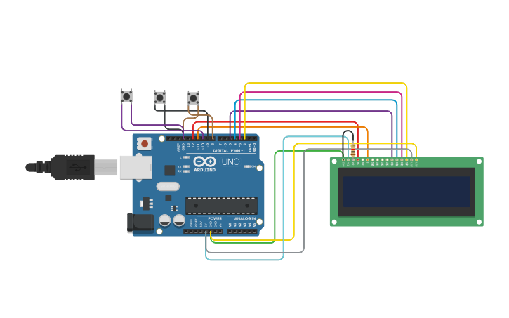
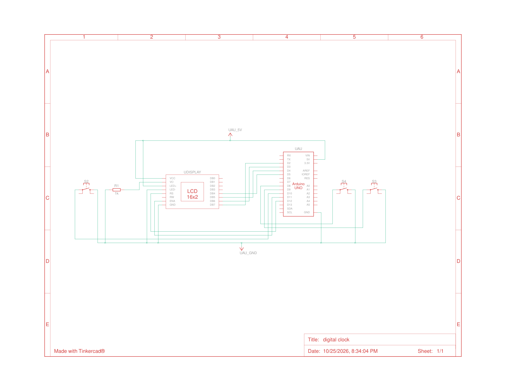

# 🕒 Digital Clock — Arduino Uno + 16×2 LCD


-00599C?logo=cplusplus&logoColor=white)

A **digital clock** built around an **Arduino Uno R3** and a **16×2 character LCD**, featuring a menu-driven interface with three pushbuttons. Set the hours, minutes, and seconds independently, and switch between **12-hour / 24-hour** display formats — all with non-blocking `millis()` timekeeping, so the clock never freezes while you navigate the menus.

The project was designed and wired in **Tinkercad Circuits**, making it easy to simulate before building on real hardware. The circuit was improved based on a valuable suggestion that came from a **discussion with an AI assistant (Claude Codes) during debugging**.

## 📷 Circuit Preview

**Wired breadboard view (Tinkercad):**



**Full schematic:**



## ✨ Features

- ⏱️ **Accurate 1-second ticks** using `millis()` — no `delay()` in the main loop
- 🕐 **12-hour display (AM/PM) and 24-hour format** — toggle anytime
- 🧭 **Menu-driven setup** — hours, minutes, and seconds can be set independently
- 🖱️ **Three pushbuttons** (MODE / UP / DOWN) with 250 ms software debouncing
- 🔌 **`INPUT_PULLUP` wiring** — buttons are tied to `GND`, no external pull-up resistors needed
- 📟 **Live status line** — the LCD's second row always shows what mode you're in
- 🐞 **Serial debug output** — button presses are logged at 9600 baud for troubleshooting

## 🧰 Bill of Materials

| Ref | Qty | Component |
|-----|:---:|-----------|
| UAU | 1 | Arduino Uno R3 |
| UDISPLAY | 1 | LCD 16×2 |
| R1 | 1 | 1 kΩ Resistor |
| S2, S3, S4 | 3 | Pushbutton |

Full material list also available in [`bom.csv`](bom.csv).

## 🔌 Wiring

| LCD 16×2 pin | Arduino Uno pin |
|:------------:|:---------------:|
| RS | D12 |
| ENA | D11 |
| DB4 | D5 |
| DB5 | D4 |
| DB6 | D3 |
| DB7 | D2 |
| VO (contrast) | 1 kΩ resistor (RWM divider) |
| R/W | GND |
| VCC / LED+ | 5 V |
| GND / LED- | GND |

| Pushbutton | Arduino Uno pin | Operation |
|:----------:|:---------------:|-----------|
| S2 · MODE | D10 | Cycles modes: Clock → Set Hours → Set Minutes → Set Seconds → Format |
| S3 · UP | D9 | Increment selected field / toggle 12↔24-hour |
| S4 · DOWN | D8 | Decrement selected field / toggle 12↔24-hour |

> All buttons use the Arduino's internal pull-up resistors (`INPUT_PULLUP`) and connect to `GND` when pressed.

## 💡 How It Works

`digital_clock1.ino` runs an **event-driven state machine**:

```
menuMode 0 → Normal clock (time ticks every second on the LCD)
menuMode 1 → Set Hours     (UP/DOWN adjust hours)
menuMode 2 → Set Minutes   (UP/DOWN adjust minutes)
menuMode 3 → Set Seconds   (UP/DOWN adjust seconds)
menuMode 4 → Format        (UP/DOWN toggle 12-hour ↔ 24-hour)
```

1. **`handleButtons()`** reads the three buttons, applies debounce, and routes presses to the active mode.
2. **`updateTime()`** advances the clock once per second *only* in normal mode — during editing, the ticking is suspended so the field you're adjusting doesn't run away from you.
3. **`drawDisplay()`** renders `HH:MM:SS AM/PM` on row 1 and the active mode on row 2.

Because timekeeping is based on `millis()` elapsed-time checks rather than `delay()`, button input is never blocked and the loop stays responsive.

## 🚀 Getting Started

### Simulate in Tinkercad (no hardware needed)

1. Open [Tinkercad Circuits](https://www.tinkercad.com/circuits) and recreate the wiring shown in the preview above.
2. Paste `digital_clock1.ino` into the code editor.
3. Click **Start Simulation** — open the Serial Monitor to see button-press debug logs.

### Run on real hardware

1. Assemble the circuit per the wiring tables (or the schematic in [`docs/`](docs/)).
2. Open [`digital_clock1.ino`](digital_clock1.ino) in the Arduino IDE, select your board (**Arduino Uno**) and port.
3. Click **Upload**. The clock boots with `12:00:00` and prints `Clock Starting...` on the LCD.

## 📁 Project Structure

```
DigitalClock/
├── digital_clock1.ino        # Main Arduino sketch (all clock logic)
├── bom.csv                   # Bill of materials
├── images/
│   └── wiring_diagram.png    # Wired breadboard view (Tinkercad)
└── docs/
    ├── breadboard_schematic.png  # Rendered circuit schematic
    └── tinkercad_schematic.pdf   # Original Tinkercad schematic export
```

## 🎯 Possible Improvements

- Add **DS3231 RTC** module so time survives power loss
- Alarm function with buzzer
- Custom LCD characters for smoother animations (e.g. blinking colon)
- EEPROM-stored time so settings persist across reset

## 📄 License

This project is licensed under the **GNU General Public License v3.0** — see the [LICENSE](LICENSE) file for details.

## 👤 Author

**Subodh Pant** — [GitHub Profile](https://github.com/sbdhpnt0607)
